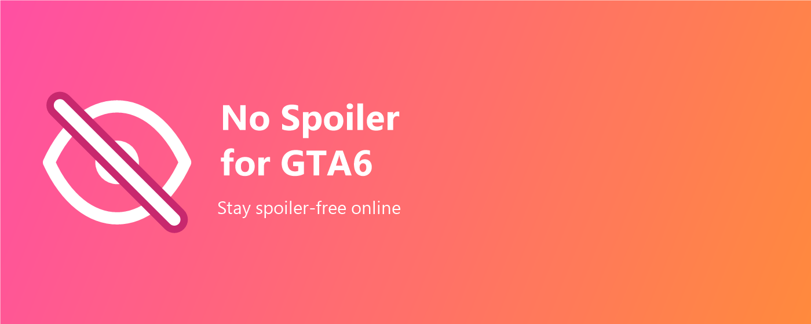
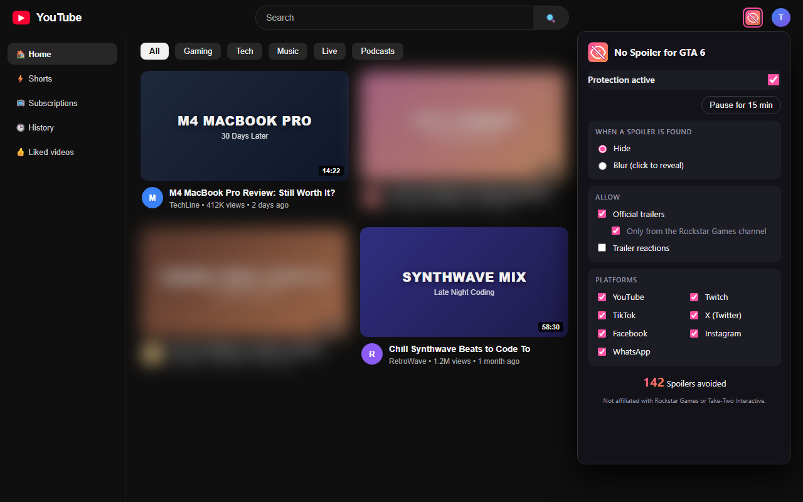
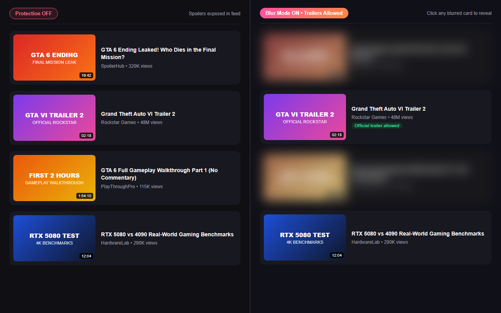

<p align="center">
  
</p>

<h1 align="center">No Spoiler for GTA6</h1>

<p align="center">
  <strong>Stay spoiler-free online.</strong> A lightweight, privacy-first Chrome extension (Manifest V3) that hides or blurs GTA 6 spoilers across your feeds, searches, streams, and messages.
</p>

<p align="center">
  <a href="https://tomascorreiaa.github.io/gta6-no-spoiler/">Privacy Policy</a> •
  <a href="https://curredev.com">CurreDev</a> •
  <a href="https://github.com/TomasCorreiaa/gta6-no-spoiler/issues">Report Issue</a>
</p>

---

## Supported Platforms

Enable or disable protection individually per platform in the extension popup:

- **YouTube** (homepage, search, channels, recommendations, Shorts, comments, and watch-page overlay)
- **Twitch** (browse, followed/recommended sidebar, search, live streams, VODs, clips, and chat)
- **TikTok** (For You feed, search, profiles, and direct video links)
- **X (Twitter)** (tweets, replies, quotes, and trending topics)
- **Facebook** (feed posts and groups)
- **Instagram** (feed posts, Explore grid, and Reels)
- **WhatsApp Web** (individual messages and last-message previews, keeping chats accessible)

## Features

- **Hide or Blur Mode:** completely remove spoilers from view or blur them with click-to-reveal.
- **Trailers & Reactions (optional):** allow official trailers (with a *Rockstar Games channel only* option) and trailer reactions while still blocking leaks, breakdowns, and gameplay spoilers.
- **Strict Mode:** optionally block ambiguous terms like `Vice City`, `Lucia`, and `Rockstar`.
- **Custom Lists:** add your own keywords, blocked channels, or always-allowed channels.
- **Quick Pause:** pause protection for 15 minutes with one click.
- **Multi-language:** localized in 10 locales (`en`, `en_GB`, `pt_PT`, `pt_BR`, `es`, `de`, `fr`, `it`, `zh_CN`, `zh_TW`).
- **100% Local & Private:** zero analytics, zero tracking, no external servers.

## Screenshots

| Extension Popup | Protection OFF vs Blur Mode ON |
|---|---|
|  |  |

## Install Locally (Developer Mode)

1. Clone or download this repository.
2. Open `chrome://extensions` in Chrome and enable **Developer mode**.
3. Click **Load unpacked** and select the repository folder.

## Development

```bash
# Run filter unit tests
npm test

# Build Chrome Web Store ZIP package into dist/
npm run package
```

---

<p align="center">
  <sub>Not affiliated with, endorsed, or sponsored by Rockstar Games or Take-Two Interactive.</sub>
</p>

